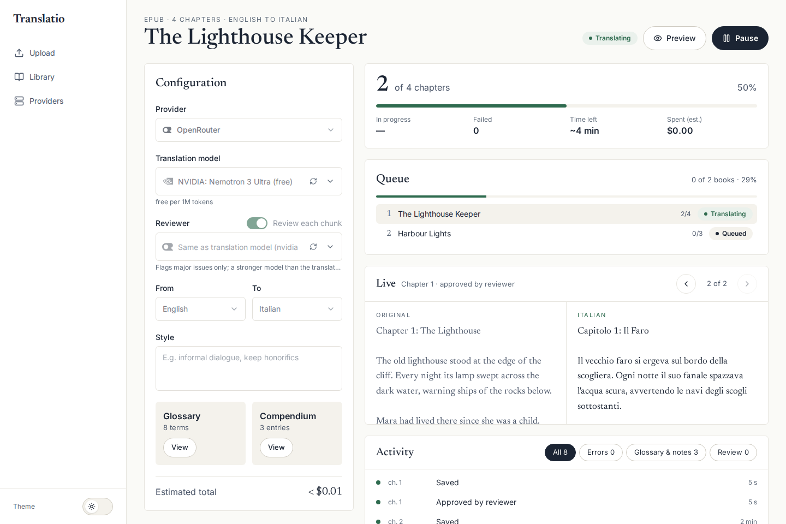
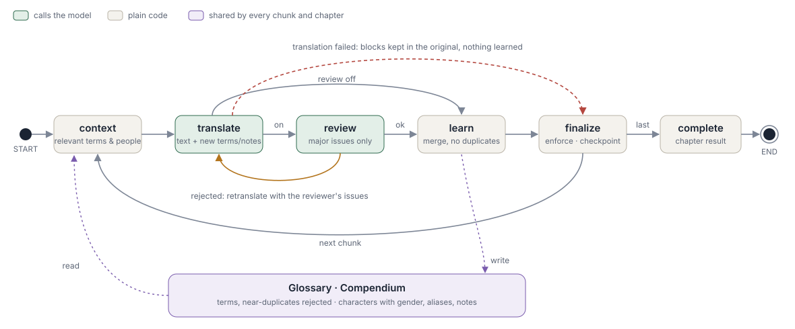
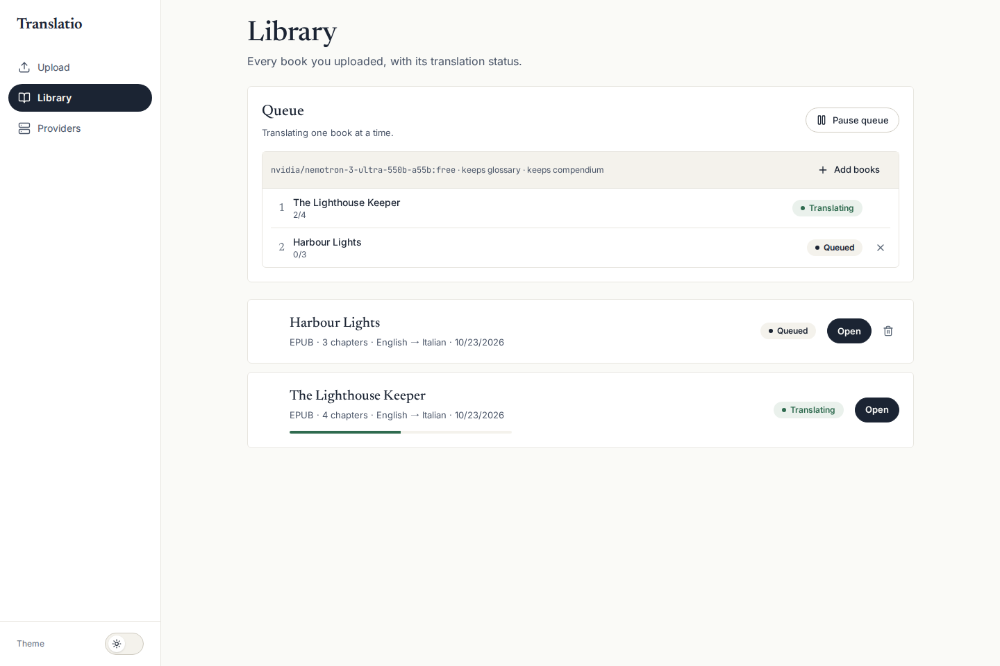
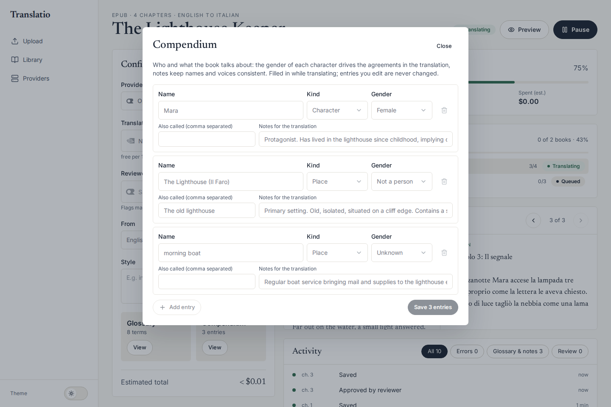
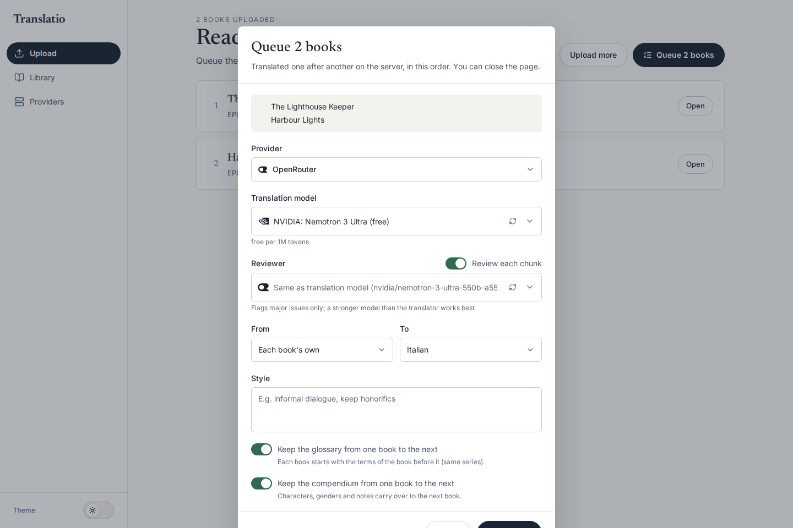
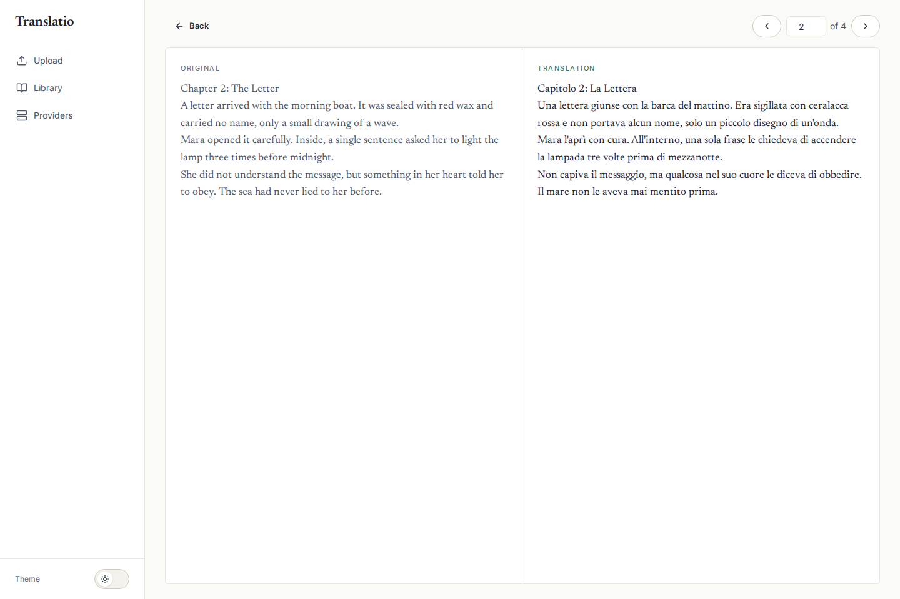
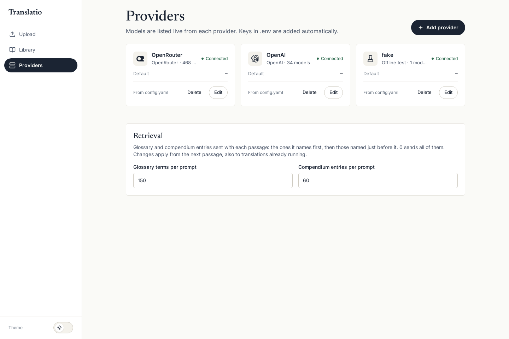
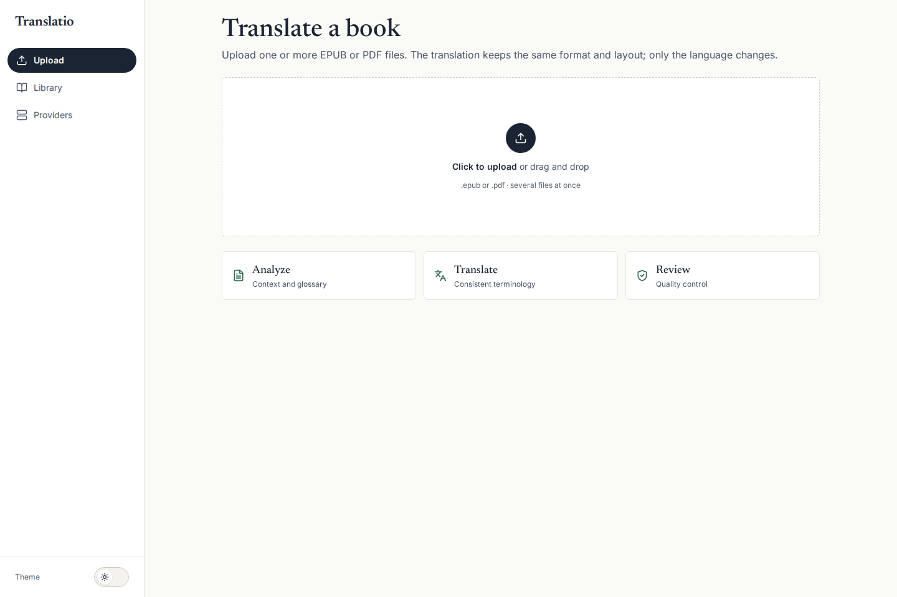

# Translatio

Translate whole books — EPUB and PDF — with LLMs, keeping the original format and layout.
Only the language changes. A per-book glossary and compendium keep names, terms and the
gender of every character consistent from the first page to the last.



## Features

- **Same format, same layout**: EPUB in → EPUB out, PDF in → PDF out. Structure, images, inline formatting and page layout are kept; PDF text is re-typeset in place with metric-compatible fonts (subset, so the file stays the size of the original).
- **Agentic pipeline on LangGraph**: analysis → per chunk *context → translate → review → learn → finalize* → doubt review ([diagram below](#how-a-chapter-is-translated)). A reviewer flags only major issues and the chunk is retranslated with them.
- **Glossary**: built while translating, enforced; near-duplicates (*Demon Kings* / *Demon King*, *Kingdom of Asura* / *Asura Kingdom*, spelling variants) are recognised and never added twice. Each prompt gets only the terms its passage uses (plurals and possessives included), the passage's own first.
- **Compendium**: characters with their gender, aliases and translation notes, plus places and other recurring elements. English often leaves gender implicit, Italian never does: the translator uses it for every agreement and the reviewer treats a wrong gender as a major issue. A guessed gender is corrected when the text proves otherwise (the quote is kept as evidence).
- **Edit while translating**: change or delete a single glossary term or compendium entry at any time; the running job uses it from the next chunk.
- **Doubts**: the translator bookmarks what it had to guess (a gender not revealed yet, who *she* is, an unknown term); a corrected gender bookmarks the passages already translated. At the end of the book a dedicated review revisits them with everything learned since and fixes what was wrong.
- **Fewer, fuller calls**: chunks of a configurable size (default ~1000 tokens); short PDF pages are translated together, so a sentence crossing pages stays in one call.
- **Switches**: turn the analysis, glossary (use / learn / enforce), compendium (use / learn), per-chunk review and doubt review on or off per run.
- **Queues**: upload several books at once, translate them in order or in parallel on the server, reorder them by drag and drop, add books to a running queue, and share glossary and compendium live across a series. The translate page follows the queue to its next book.
- **Resumable**: progress is checkpointed per chunk. Pause, a closed page, a crash or a restart never lose finished work; failed parts are retried on resume.
- **Live view**: progress, ETA, cost so far, the current passage side by side and a filterable activity log.
- **Cost estimate** per model before you start, from the book's real chunks and daily-updated prices.
- **Providers**: OpenAI, Anthropic, OpenRouter, Ollama, any OpenAI-compatible endpoint; models listed live from each provider; rate limits, retries with backoff and per-provider concurrency.
- **Runs in Docker**: nothing to install on the host but Docker.

## How a chapter is translated



Each chapter (or PDF page) is split into chunks of whole paragraphs and runs through a LangGraph `StateGraph`. Only *translate* and *review* call the model:

| Node | What it does |
| --- | --- |
| **context** | Picks the glossary terms and compendium entries the chunk mentions — also in the text right before it, since a *she* may refer to someone named earlier. |
| **translate** | Translates the chunk (one output paragraph per source paragraph, inline markup kept as placeholders) and, in the same call, reports new terms and what the passage reveals about characters and places. |
| **review** | Optional. Checks meaning, omissions, glossary and gender against the compendium; only *major* issues reject the chunk, which is retranslated with them. |
| **learn** | Merges the new terms (near-duplicates rejected) and the compendium updates (only facts the text states; a known gender changes only with a quote that proves it; your own edits are never changed), and bookmarks the translator's doubts. |
| **finalize** | Enforces the glossary and saves the checkpoint used to resume. |

Before the first chapter, an analysis of the opening pages seeds the glossary and the compendium with the main terms and characters. Chapters run concurrently (bounded), sharing the same glossary and compendium; consecutive short PDF pages go through the graph together. When every chapter is done, the **doubt review** sends each bookmarked passage, with the final glossary and compendium, to the review model; a fix is applied only if it keeps the paragraph and its inline markup. Then the book is saved.

## Screenshots

| | |
| --- | --- |
|  |  |
| **Library** — queues, per-book status, add books to a running queue | **Compendium** — gender, aliases and notes per character |
|  |  |
| **Queue** — one set of settings, glossary and compendium carried over | **Preview** — original and translation side by side |
|  |  |
| **Providers** — live status and models of each provider | **Upload** — one or more EPUB/PDF files |

## Quick start

Only Docker is required: development, tests and linting all run in containers.

1. Put your API keys in a `.env` at the repo root (see [`.env.example`](.env.example); `OPENAI-API-KEY` style names work too).
2. Start the stack:

   ```powershell
   ./run.ps1 start          # development, hot reload
   ./run.ps1 start -Prod    # production images
   ./run.ps1 stop           # add -Prod if started with -Prod
   ```

   or directly:

   ```bash
   docker compose -f docker-compose.yml -f docker-compose.dev.yml up --build   # development
   docker compose up --build                                                   # production
   ```

3. Open <http://localhost:3000> (API at <http://localhost:8000>).

All data — uploads, translated files and the SQLite database — lives in the repo-root `data/` folder.

## Usage

1. **Upload** one or more EPUB/PDF files. A single book shows its cost estimate per model.
2. **Translate**: pick provider, model, optional reviewer model, languages and style, then start — or **Queue N books** to translate several in a row.
3. **Follow** the progress live; edit the glossary and the compendium whenever the translation is paused. You can close the page: the job runs on the server.
4. **Preview** original and translation side by side, then **Download** the translated file.

## Configuration

`config.yaml` (repo root, mounted read-only) is applied at startup:

```yaml
providers:                 # upserted by name; skipped if their key is missing from .env
  - name: OpenRouter
    type: openrouter
    api_key_env: OPENROUTER_API_KEY
    params:
      requests_per_second: 0.25   # per-provider overrides: max_concurrency, max_retries, ...
  - name: OpenAI
    type: openai
    api_key_env: OPENAI_API_KEY

translation:               # defaults for every job
  max_concurrency: 2       # chapters translated in parallel
  chunk_tokens: 1000       # text per call (300–3000); short PDF pages are grouped up to it
  requests_per_second: 0.5
  llm_max_retries: 5       # SDK retries with backoff on 429/5xx
  chain_retries: 3         # retries of a whole call (invalid structured output)
  enable_review: true

pricing:
  models:                  # models shown in the cost estimate
    openai: [gpt-4.1-nano, gpt-4.1-mini, gpt-5.4-mini, gpt-6-luna]
```

Without a `providers:` section, one provider is created per known key in `.env` (OpenAI, OpenRouter, Anthropic). Providers can also be added and edited from the **Providers** page.

| Provider | Type | Notes |
| --- | --- | --- |
| OpenAI | `openai` | GPT-4.1, GPT-5.x, GPT-6, o-series (reasoning models handled automatically) |
| Anthropic | `anthropic` | Claude models |
| OpenRouter | `openrouter` | Hundreds of models, many free (`:free`), prices read from the listing |
| Ollama | `ollama` | Local models, listed from the Ollama server |
| Custom | `custom` | Any OpenAI-compatible endpoint (vLLM, LM Studio, Together, …) |
| Fake | `fake` | Offline test provider, deterministic output, no key |

## Architecture

```text
├── frontend/              React 19 + Vite + Tailwind v4 (Bun)
│   └── src/               pages (upload, translate, library, providers, preview), components, API client
├── backend/               FastAPI + LangChain/LangGraph + SQLAlchemy (SQLite)
│   ├── app/agents/        analyzer, translator, reviewer, chapter graph, glossary, compendium
│   ├── app/services/      job runner and queue, documents (EPUB/PDF), chunker, persistence, pricing
│   ├── app/api/           REST + WebSocket
│   └── tests/             pytest, scripted fake LLMs (no network)
├── docs/                  diagram and screenshots
├── config.yaml            providers and defaults
└── docker-compose*.yml    production + development override
```

Developer notes (commands, architecture in depth, conventions) are in [CLAUDE.md](CLAUDE.md).

## Development

```bash
DC="docker compose -f docker-compose.yml -f docker-compose.dev.yml"
$DC run --rm --no-deps backend pytest            # backend tests
$DC run --rm --no-deps backend pytest -m live    # real-provider smoke tests (uses API quota)
$DC run --rm frontend bun run lint               # frontend lint
./format.ps1                                     # isort, black, ruff, eslint, tsc
```
